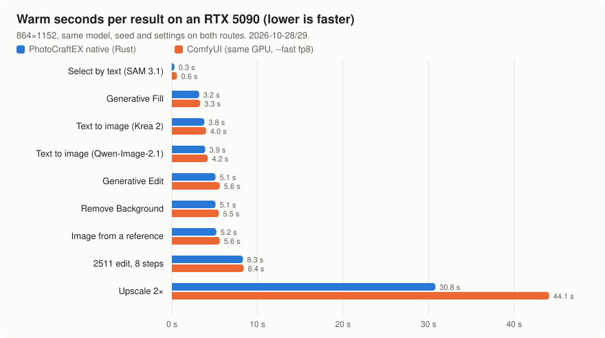
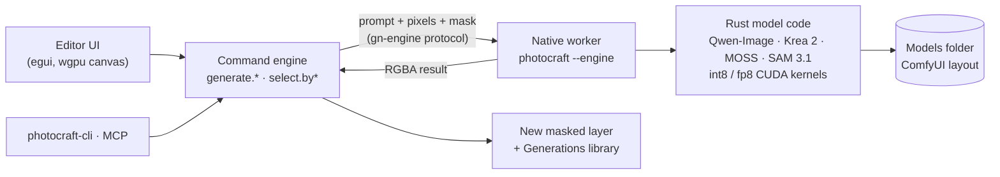

<p align="center">
  
</p>

<h1 align="center">ShotoPhopEX</h1>

<p align="center">
  <b>A full image editor with a local generative AI studio built in, written in Rust and running on your own GPU.</b><br>
  Generative Fill, Expand, Edit, Remove, text-to-image, Upscale, Split into Layers and Select by text,<br>
  on open-weight models, in one native app. No cloud, no account, no Python, no ComfyUI.
</p>

<p align="center">
  
  
  
  
  
  
</p>

<p align="center">
  <a href="#-what-it-adds">What it adds</a> ·
  <a href="#-benchmarks">Benchmarks</a> ·
  <a href="#-install">Install</a> ·
  <a href="#-agentic-install">Agentic install</a> ·
  <a href="#-models">Models</a> ·
  <a href="#-roadmap">Roadmap</a> ·
  <a href="#-the-editor-underneath">The editor</a>
</p>

<br>

<p align="center">
  
</p>

<!--
  Generative screenshots go here (docs/images/genai/): Generative Fill with its Variations strip,
  Generate Image in the Generate panel, Remove with one stroke, Split into Layers, Select by text.
-->

ShotoPhopEX is a fork of [PhotoCraft](https://github.com/storytold/photocraft), the clean-room,
pure-Rust reimplementation of a professional layered image editor. Upstream deliberately left
generative AI out. This fork puts it in, the way a working artist wants it: every result lands on
its own masked layer, the original pixels never change, and every model runs on your own machine.

The generative engine is a native Rust worker (`photocraft --engine`) with its own CUDA kernels.
It reads model weights straight from a folder in ComfyUI's layout, so you can reuse files you
already have, and it is now faster than ComfyUI itself on 11 of the 13 features it was measured
on.

<table>
  <tr>
    <td width="25%" valign="top">
      <h3>🎨 Firefly-class tools</h3>
      Fill, Expand, Edit, Remove, Remove Background, Angles, Upscale and Split into Layers, all from a selection and a prompt.
    </td>
    <td width="25%" valign="top">
      <h3>⚡ Faster than ComfyUI</h3>
      Our own int8 kernels, a resident text encoder and merged LoRAs. Upscale 2× runs in 24.2 s where ComfyUI takes 44.1 s.
    </td>
    <td width="25%" valign="top">
      <h3>🔒 Local and private</h3>
      One executable plus NVIDIA's libraries. Nothing leaves your PC, and nothing needs an account or a credit.
    </td>
    <td width="25%" valign="top">
      <h3>🤖 Agent-ready</h3>
      Every generative action is a command, so the UI, the CLI and an MCP server can all drive it.
    </td>
  </tr>
</table>

## ✨ What it adds

| Feature | What it does | Default model | Warm time on an RTX 5090 |
|---|---|---|---|
| **Generate Image** | Text to image, into a new layer or document, with optional reference pictures | Qwen-Image-2.1 (Krea 2 Turbo selectable) | **3.9 s** |
| **Image from a reference** | A new picture steered by up to ten references | Qwen-Image-2.1 | **5.2 s** |
| **Generative Fill** | Repaint the selection from a prompt, on a masked layer, with variations | Qwen-Image-2.1 | **3.2 s** |
| **Fill from a reference** | Repaint the selection with what a reference picture shows | Qwen-Image-2.1 edit | 9.6 s |
| **Remove** | One stroke over an object: it is found, named, removed with its shadow, and the best of two tries is kept | Qwen-Image-2.1 edit + SAM 3.1 | **4.3 s** |
| **Generative Edit** | Change what is in the picture by instruction ("make the jacket leather") | Qwen-Image-2.1 | **5.1 s** |
| **Generative Expand** | Grow the canvas and continue the scene | Qwen-Image-2.1 | 10.0 s |
| **Remove Background** | A soft alpha matte from the model's own RGBA output, as a layer mask | Qwen-Image-2.1 | **5.1 s** |
| **Generative Angles** | Orbit a camera around the subject (8 directions, 4 heights, 3 distances) | Qwen-Image-2.1 edit | 10.1 s |
| **Generative Upscale 2×** | Enlarge with new detail on a few large tiles, staying on the original | Qwen-Image-2.1 edit + Restore LoRA | **24.2 s** |
| **Split into Layers** | Decompose a flat picture into separate RGBA layers | Qwen-Image-Layered | **92.6 s** (3 layers) |
| **Select Subject / by text / by point** | Open-vocabulary selection: "the red car", "eye:2", or a click | SAM 3.1 | **0.3 s** |
| **MOSS-Image** | Permissive (Apache-2.0) text to image with strong text rendering | MOSS-Image SFT, 5B | 11.0 s (1024², 50 steps) |
| **Prompt Enhance** | Rewrites a short prompt into a full one, reading the picture | Qwen3-VL | ~1–2 s |

Times are warm, through the app, at 864×1152 (about 1 MP). Bold rows are faster than ComfyUI on
the same GPU. Every feature also takes **LoRAs** from your models folder, and Qwen-Image-Edit-2511
is selectable for Fill, Edit, Remove, Expand and Angles at 4.4–7.3 s with its Lightning LoRAs. With warm-up on (the default), the
first image right after launch takes 3.6 s (Krea 2) or 3.7 s (2.1) instead of 12.6–15.3 s.

**How it feels in the app**

- **Window › Generate** is the panel in the dock: a switch for Image, Fill, Edit or Expand, then
  References (drop pictures on it), Prompt and Settings (model, quality, size, count), and one
  **Generate** button (Ctrl+Enter). Auto names the model it will use.
- **Live preview** paints the picture on the canvas as it forms, step by step. Fast (the default)
  costs nothing measurable; Sharp decodes a full-size preview every third step for about 0.2 s a
  run. The finished picture is byte-identical either way.
- **Under any selection**, a task bar offers Fill or Edit right where you are working.
- **The Variations strip** at the canvas edge keeps the last runs as tiles: keep one, drop one, or
  ask for more like it.
- **Window › Generations** is the library of every run, with Recreate, Place, Save and Copy prompt.
- **The Object Selection tool (W)** tints what a click would select before you click, then refines
  with include and exclude points. Quick Selection selects whole objects under a stroke.
- **The engine dot** in the status bar shows the worker's state, with Start, Stop, Purge models
  and Show log.

## 📊 Benchmarks

<p align="center">
  <picture>
    <source media="(prefers-color-scheme: dark)" srcset="docs/images/genai/bench-5090-dark.svg">
    
  </picture>
</p>

Same model, same seed, same settings and the same picture on both routes, one route on the GPU at
a time, wall seconds through the app's CLI. "Warm" is the second request with a new seed (a
repeated request would hit ComfyUI's cache). ComfyUI ran with `--fast fp8_matrix_mult`.

| Feature (864×1152, warm) | RTX 5090 native | RTX 5090 ComfyUI | Speed-up | RTX 3090 native |
|---|---:|---:|---:|---:|
| Select by text (SAM 3.1) | **0.3 s** | 0.6 s | 2.0× | pending |
| Generative Fill (2.1) | **3.2 s** | 3.3 s | 1.03× | pending |
| Text to image (Krea 2 Turbo, 8 steps) | **3.8 s** | 4.0 s | 1.05× | pending |
| Text to image (Qwen-Image-2.1, 25 steps) | **3.9 s** | 4.2 s | 1.08× | pending |
| Generative Edit (2.1) | **5.1 s** | 5.6 s | 1.10× | pending |
| Remove Background (2.1 matte) | **5.1 s** | 5.5 s | 1.08× | pending |
| Image from a reference (2.1) | **5.2 s** | 5.6 s | 1.08× | pending |
| 2511 Angles (4 steps) | **4.4 s** | 4.5 s | 1.02× | pending |
| 2511 edit (Lightning, 8 steps) | **7.25 s** | 8.4 s | 1.16× | pending |
| 2511 full-quality edit (40 steps, CFG 4) | 86.8 s | 81.9 s | 0.94× | pending |
| Generative Upscale 2× | **24.2 s** | 44.1 s | 1.82× | pending |
| Split into Layers (3 layers, Qwen-Image-Layered) | **92.6 s** | 124.8 s | 1.35× | pending |
| MOSS-Image (1024², 50 steps) | 11.0 s | 10.8 s | 0.98× | pending |

**RTX 5090:** 32 GB, Windows 11, measured 2026-10-28 and 2026-10-29. Upscale was measured
against ComfyUI 0.43 with the same Restore LoRA at 0.5; natively it now runs 2×2 tiles of up to
1.15 MP by default, where the ComfyUI route runs six square tiles. **RTX 3090:** the 24 GB tier is next on
the [roadmap](#-roadmap); no numbers have been measured on one yet, so none are shown. Every run,
its script and the raw reading are in [`docs/comfy/benchmarks.md`](docs/comfy/benchmarks.md).

What made it fast: Qwen-Image-2.1 runs as an int8 ConvRot DiT built once from the bf16 weights
and cached, through our own kernels and a flash-attention path. The text encoder stays resident
between requests, the conditioning is cached when only the seed changes, LoRAs are merged into
the resident int8 weights once instead of costing a side path every step, and the 20 GB 2511 DiT
stays resident between requests. Qwen-Image-Layered and 2511 run SageAttention2 (INT8
attention) on every block where it holds the picture, and Upscale works on fewer, larger tiles. Outputs were checked against the ComfyUI route at every step
(within 0.06/255, or byte-identical).

## 🚀 Install

> [!IMPORTANT]
> **There is no one-click download yet.** No release has been published on this repository, so
> today the app is built from source. When the first release is up, the normal install becomes:
> download `photocraft-<version>-windows-x64-portable.zip`, unzip, run `photocraft.exe`, and point
> it at your models folder. The engine's crates live in a separate repository
> (`CodyChuGit/genai-native`) that is private for now, so building it needs access to that
> repository.

### What you need

| | |
|---|---|
| **GPU** | NVIDIA RTX 5090 (32 GB), the tier everything is tuned for today. Other cards are on the [roadmap](#-roadmap). |
| **OS** | Windows 10 or 11, x64 |
| **Disk** | About 60 GB for the default models, more for the 2511 and Layered extras |
| **Build tools** | Git, Rust (rustup, MSVC toolchain), Visual Studio 2022 Build Tools (C++), CUDA Toolkit 13, the CUTLASS headers |

### Normal install (build from source)

**1. Install the tools** (PowerShell, once):

```powershell
winget install Git.Git Rustlang.Rustup Nvidia.CUDA
winget install Microsoft.VisualStudio.2022.BuildTools --override "--quiet --wait --add Microsoft.VisualStudio.Workload.VCTools --includeRecommended"
git clone --depth 1 https://github.com/NVIDIA/cutlass C:\src\cutlass
```

**2. Build the app with the engine compiled in** (from an "x64 Native Tools Command Prompt for VS 2022"):

```bat
git clone -b photoshopex https://github.com/CodyChuGit/comfy-photocraft
cd comfy-photocraft
set CUDA_COMPUTE_CAP=120
set CUTLASS_DIR=C:\src\cutlass\include
set NVCC_APPEND_FLAGS=-Xcompiler /Zc:preprocessor -Xcompiler /MD -std=c++17
cargo build --release -p photocraft -p photocraft-cli --features native-diffusion
```

`CUDA_COMPUTE_CAP=120` targets the RTX 50 series. The first build takes a while, because it
compiles the CUDA kernels too.

**3. Download the models** into one folder, for example `D:\PhotoCraftModels`, in ComfyUI's
layout. The [model table](#-models) lists every file and where it goes. If you already have
ComfyUI, its `models` folder works as it is.

**4. Run it.** Start `target\release\photocraft.exe`, open **Edit › Preferences › AI
Integrations**, set **Models folder** to your folder and **Native runtime folders** to your CUDA
Toolkit's `bin\x64`, then press **Generate**. The first request loads the model; the ones after
it run at the warm times above.

**Optional: make a portable folder** to copy to another PC, with the CUDA libraries beside the exe:

```powershell
pwsh packaging/windows/runtime.ps1 -Cuda "$env:CUDA_PATH\bin\x64"
pwsh packaging/windows/package.ps1 -Arch x64 -Native -NoMsi -SkipBuild
```

## 🤖 Agentic install

Let a coding agent (Claude Code, Codex, or any agent with a terminal) do the whole install. Open
it in an empty folder on the Windows PC and paste this:

```text
Install ShotoPhopEX (https://github.com/CodyChuGit/comfy-photocraft, branch photoshopex) on this
Windows PC and get its generative features working. Follow the README's "Install" and "Models"
sections exactly. Work in this order and stop to ask me if a step fails:

1. Run nvidia-smi and tell me the GPU and driver. Stop if there is no NVIDIA GPU.
2. Check for Git, rustup (MSVC toolchain), Visual Studio 2022 Build Tools with the C++ workload,
   the CUDA Toolkit 13 and the CUTLASS headers. Install whatever is missing with winget, as the
   README shows. Ask me before installing anything.
3. Clone the repository on the photoshopex branch and build photocraft and photocraft-cli with
   --features native-diffusion from a VS 2022 x64 developer environment, setting CUDA_COMPUTE_CAP
   for this GPU (120 for RTX 50-series, 89 for RTX 40-series, 86 for RTX 30-series), CUTLASS_DIR
   and NVCC_APPEND_FLAGS as the README shows.
4. Ask me where the models folder should go (suggest a drive with 60 GB free). Create the
   ComfyUI layout in it (diffusion_models, text_encoders, vae, loras, checkpoints) and download
   the README's default models from Hugging Face into the right subfolders. Skip any file that is
   already there. If a repository is gated, tell me which licence to accept and wait.
5. Check every downloaded file's size against Hugging Face and list what you installed.
6. Start target\release\photocraft.exe and tell me to set Edit > Preferences > AI Integrations >
   Models folder to that folder and Native runtime folders to the CUDA Toolkit's bin\x64.
7. When I say it is set, run one generation through photocraft-cli (check
   `photocraft-cli run --help` for the syntax) and report how long it took.
```

The agent can drive the app after that too. Every generative action is a command, so a prompt
like "select the car and turn it into a red vintage bicycle" works over the CLI or MCP:

```sh
photocraft-cli run street.jpg \
  --cmd select.byText  --params '{"prompt":"the parked car"}' \
  --cmd generate.fill  --params '{"prompt":"a red vintage bicycle leaning on the wall"}' \
  --out street-bicycle.png

photocraft-cli mcp   # expose all 500+ commands, generative ones included, to an MCP agent
```

## 🧠 Models

The app ships no weights. You bring them, under each model's own licence, into one folder in
ComfyUI's layout. Files come from the Comfy-Org repacks on Hugging Face (their `split_files/`
folders).

**Defaults (what Auto uses)**

| Folder | File | From | Used for |
|---|---|---|---|
| `diffusion_models/` | `qwen_image_2.1_int8_convrot.safetensors` | `Comfy-Org/Qwen-Image-2.1` | Image, Fill, Edit, Expand, Remove, Remove Background, Angles, Upscale |
| `text_encoders/` | `qwen3vl_8b_int8_convrot.safetensors` | `Comfy-Org/Qwen-Image-2.1` | the 2.1 text encoder, and the prompt rewriter |
| `vae/` | `qwen_image_2.1_vae_bf16.safetensors` | `Comfy-Org/Qwen-Image-2.1` | 2.1's VAE (with alpha) |
| `loras/` | `qwen-image-2.1-restore.safetensors` | `ausboss/Qwen-Image-2.1-Restore-LoRA` | Upscale |
| `checkpoints/` | `sam3.1_multiplex_fp16.safetensors` | `Comfy-Org/sam3.1` | every Select and the object finder |
| `diffusion_models/` | `qwen_image_layered_fp8mixed.safetensors` | `Comfy-Org/Qwen-Image-Layered_ComfyUI` | Split into Layers |
| `vae/` | `qwen_image_layered_vae.safetensors` | `Comfy-Org/Qwen-Image-Layered_ComfyUI` | Split into Layers |
| `text_encoders/` | `qwen_2.5_vl_7b_fp8_scaled.safetensors` | `Comfy-Org/Qwen-Image_ComfyUI` | Split into Layers and every 2511 route |

**Selectable extras**

| Folder | File | From | Used for |
|---|---|---|---|
| `diffusion_models/` | `krea2_turbo_fp8_scaled.safetensors` | `Comfy-Org/Krea-2` (accept Krea's licence first) | Krea 2 text to image and edit |
| `text_encoders/` | `qwen3vl_4b_fp8_scaled.safetensors` | `Comfy-Org/Krea-2` | Krea 2's text encoder, and Prompt Enhance |
| `vae/` | `qwen_image_vae.safetensors` | `Comfy-Org/Qwen-Image_ComfyUI` | Krea 2 and 2511 |
| `diffusion_models/` | `qwen_image_edit_2511_fp8mixed.safetensors` | `Comfy-Org/Qwen-Image_ComfyUI` | the 2511 routes |
| `loras/` | `Qwen-Image-Edit-2511-Lightning-8steps-V1.0-bf16.safetensors`, `…-4steps-…` | `lightx2v/Qwen-Image-Edit-2511-Lightning` | 2511 at 8 or 4 steps |
| `loras/` | `qwen-image-edit-2511-multiple-angles-lora.safetensors` | `fal/Qwen-Image-Edit-2511-Multiple-Angles-LoRA` | 2511 Angles |
| `loras/` | `krea2_style_reference.safetensors` | `ostris/krea2_turbo_style_reference` | Krea 2 style reference |
| `diffusion_models/` | `moss_image_sft_int8_convrot.safetensors` | `Comfy-Org/MOSS-Image` | MOSS-Image |
| `text_encoders/` | `qwen3.5_9b_int8_convrot.safetensors`, plus `qwen35_tokenizer/tokenizer.json` | `Comfy-Org/MOSS-Image`; the tokenizer from `OpenMOSS-Team/MOSS-Image-SFT` | MOSS-Image's text encoder |
| `vae/` | `flux2-vae_small.safetensors` | `Comfy-Org/MOSS-Image` | MOSS-Image |
| `vae_approx/` | `taew2_1.safetensors`, `taeqi2_1.safetensors` | madebyollin (MIT) | optional: Sharp live previews |

**Licences matter.** Qwen-Image-2.1 is under the Qwen Research License (research and evaluation;
commercial use needs Alibaba's agreement), and research models are on by default in this build.
Krea 2 and SAM 3.1 are under their own community licences. Qwen-Image-Edit-2511,
Qwen-Image-Layered, MOSS-Image and the Lightning and Angles LoRAs are Apache-2.0. The full catalogue, with
sizes, hashes and VRAM, is in [`docs/comfy/models.md`](docs/comfy/models.md).

## 🗺️ Roadmap

**Hardware tiers.** Everything is tuned on the RTX 5090 first; each later tier gets its own
precision plan rather than a one-size build.

| Tier | Hardware | Plan | Status |
|---|---|---|---|
| 1 | **RTX 5090** (32 GB) | int8 ConvRot everywhere, NVFP4 as an opt-in speed mode where quality holds | 🟢 in progress |
| 2 | **RTX 3090** (24 GB) | int8 only (no fp8 or fp4 tensor cores on Ampere) | 🟡 next |
| 3 | **16 GB NVIDIA cards** | 4-bit weights (NVFP4 on the 50 series, int4 on older cards), the text encoder loaded on demand, tiled VAE | ⚪ later |
| 4 | **Mac, 16 GB unified memory** (MLX) | MLX 4-bit weights, one model resident at a time; Qwen-Image-2.1 with all its features, Krea 2 and SAM fit in the 8–9 GB a 16 GB Mac leaves | ⚪ later |
| 4b | **Mac, 8 GB** ("super MOSS") | a small DiT around 2.5 GB at 4-bit with a ≤3B text encoder | ⚪ research |

**Features and speed**

- [x] Every generative feature native in Rust, no ComfyUI, no Python, no ONNX Runtime
- [x] Matching or beating ComfyUI's speed on every default feature
- [x] LoRAs on every route, merged into the resident weights
- [ ] **Speed pass:** clearly faster than ComfyUI everywhere, starting with Split into Layers and Upscale
- [ ] **Precision study:** int8 vs fp8 vs NVFP4 per model, kept only where the pictures hold
- [x] **MOSS-Image** (Apache-2.0, 5B), native and level with ComfyUI
- [x] **Live previews** while generating, at no measurable cost
- [ ] **A published release:** a portable zip and an installer, with a first-run "Get models" page that downloads the defaults
- [ ] **RTX 3090 tier**, with its own benchmark column above
- [ ] **16 GB tier and Mac**, sharing one "one model at a time, 4-bit" loading pattern

The detailed plans: [`docs/comfy/roadmap.md`](docs/comfy/roadmap.md) (phases and definitions of
done), [`docs/comfy/goals/rust-rebuild.md`](docs/comfy/goals/rust-rebuild.md) (the Rust rebuild)
and [`docs/comfy/plan-native-engine.md`](docs/comfy/plan-native-engine.md) (the engine design).

## 🏗️ How it works



- **Everything is a command.** `generate.fill`, `generate.image`, `generate.edit`,
  `generate.expand`, `generate.upscale`, `select.byText` and the rest have parameter docs, tests and
  undo, like every other command in the editor.
- **Non-destructive.** A result lands on a new layer with a mask cut from the selection, and the
  prompt, seed and model are recorded so it can be reproduced or varied.
- **Never block, never crash.** Generation runs as a background job with progress and cancel. A
  missing model or a stopped worker is a sentence in the app, not a crash.
- **One process for the models.** The worker owns loading and residency, so the editor stays
  responsive and a model's memory is freed when you ask.

Start with [`docs/comfy/README.md`](docs/comfy/README.md) for the fork's documentation, and
[`docs/comfy/architecture.md`](docs/comfy/architecture.md) for the design.

## 🖌️ The editor underneath

Everything PhotoCraft does is still here: layers, masks, adjustment layers, layer styles, live
type, vectors, brushes, filters, real PSD and PSB files, and a GPU compositor on wgpu.

<table>
  <tr>
    <td width="50%" valign="top">
      
      <b>Masks and selections</b>, which the generative tools build on.
    </td>
    <td width="50%" valign="top">
      
      <b>Layer styles and type</b>, saved to real PSD files.
    </td>
  </tr>
  <tr>
    <td width="50%" valign="top">
      
      <b>Adjustment layers</b>, all non-destructive.
    </td>
    <td width="50%" valign="top">
      
      <b>Filters</b> with live previews.
    </td>
  </tr>
</table>

<h4>🧰 68 tools</h4>
Move · Artboard · Rectangular and Elliptical Marquee · Single Row Marquee · Single Column Marquee · Lasso · Polygonal Lasso · Magnetic Lasso · Object Selection · Quick Selection · Magic Wand · Crop · Perspective Crop · Slice · Slice Select · Frame · Eyedropper · Color Sampler · Ruler · Note · Count · Remove · Spot Healing Brush · Healing Brush · Patch · Content-Aware Move · Red Eye · Brush · Pencil · Mixer Brush · Color Replacement · Clone Stamp · Pattern Stamp · History Brush · Art History Brush · Eraser · Background Eraser · Magic Eraser · Gradient · Paint Bucket · Blur · Sharpen · Smudge · Dodge · Burn · Sponge · Pen · Freeform Pen · Curvature Pen · Add Anchor Point · Delete Anchor Point · Convert Point · Horizontal and Vertical Type · Horizontal and Vertical Type Mask · Path Selection · Direct Selection · Rectangle · Ellipse · Triangle · Polygon · Line · Custom Shape · Hand · Rotate View · Zoom

The full feature list, file formats and platform notes are in upstream's
[README](https://github.com/storytold/photocraft#readme). New contributors and agents: start with
[`AGENTS.md`](AGENTS.md), then [`docs/`](docs/) and [`docs/comfy/`](docs/comfy/).

## License and credits

ShotoPhopEX is dual-licensed under [MIT](LICENSE-MIT) or [Apache-2.0](LICENSE-APACHE), at your
option, like upstream. Copyright (c) 2026 ArtCraft Team and the PhotoCraft contributors, and the
ShotoPhopEX contributors. Required notices are in [NOTICE](NOTICE); bundled fonts, icons and
images keep their own licences, listed in [ATTRIBUTION.md](ATTRIBUTION.md).

Built on [PhotoCraft](https://github.com/storytold/photocraft) by the ArtCraft team. This fork is
not made or endorsed by them, and per [`docs/brand/LICENSE-brand.txt`](docs/brand/LICENSE-brand.txt)
it does not use the ArtCraft name or logos as its own.

Model weights are not part of this repository and keep their own licences (see
[Models](#-models)). Every artwork shown is in the public domain; sources are in
[`docs/images/SOURCES.md`](docs/images/SOURCES.md).

<sub>Adobe, Photoshop and Firefly are trademarks or registered trademarks of Adobe Inc. in the United States and/or other countries. ShotoPhopEX is an independent, open-source project and is not affiliated with, sponsored by or endorsed by Adobe Inc.; these names are used only to describe the workflows it is compatible with. NVIDIA, RTX and CUDA are trademarks of NVIDIA Corporation.</sub>
